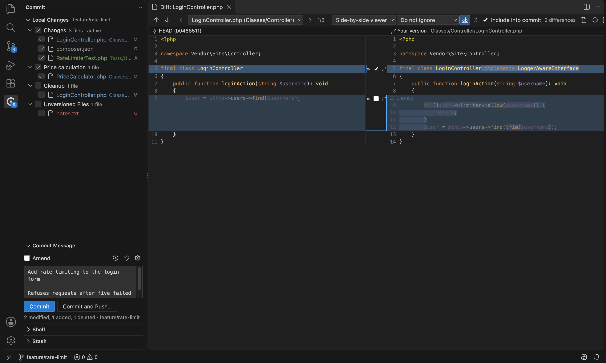
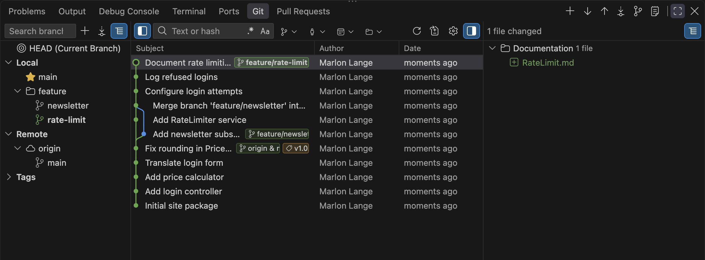
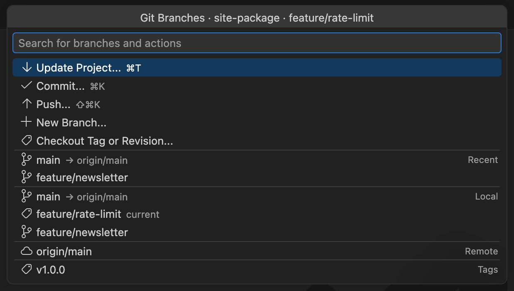
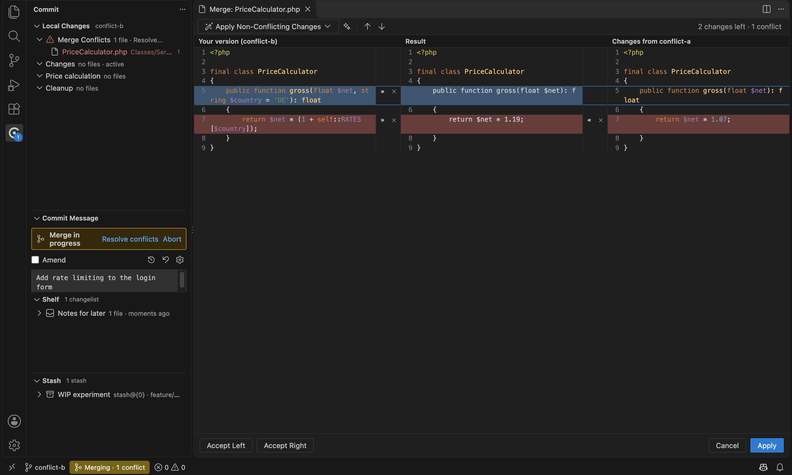
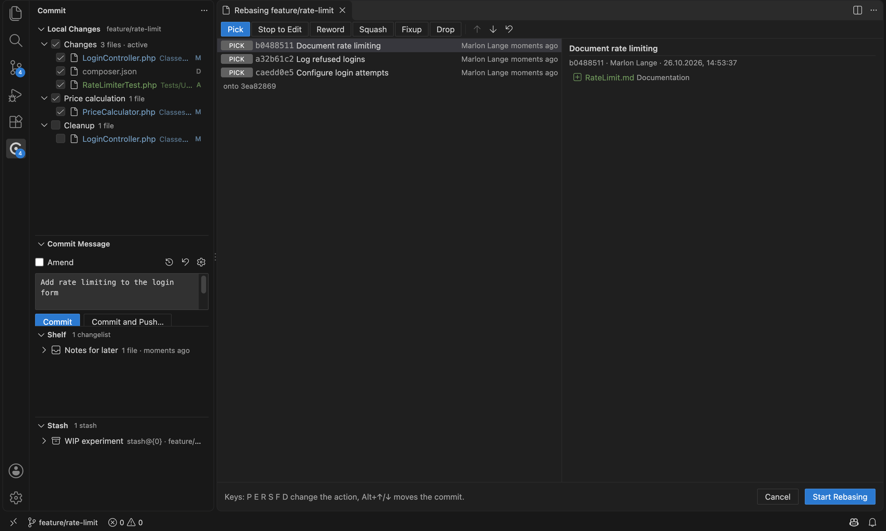
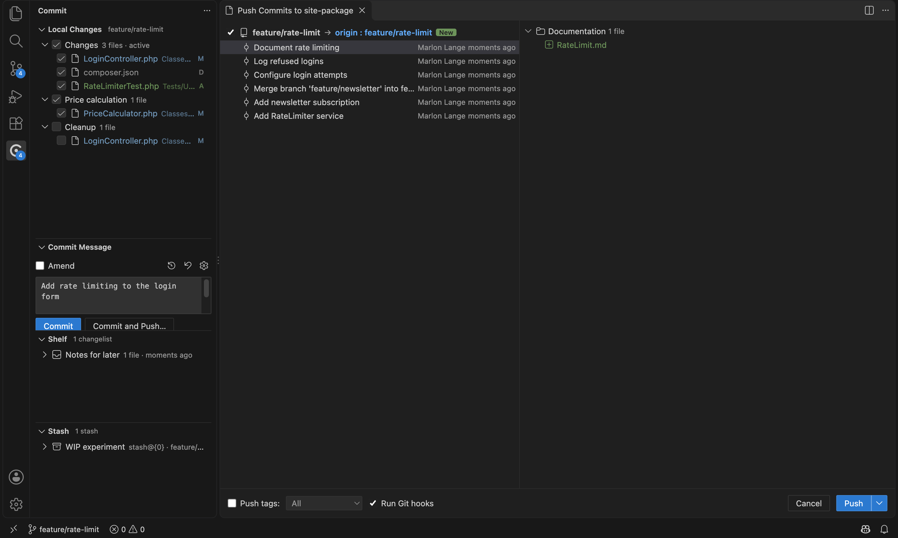

# Changeline – Changelists, Shelf & Git Log for VS Code

Changeline brings the Git workflow known from JetBrains IDEs (PhpStorm, IntelliJ IDEA, WebStorm, …) to VS Code: the **Commit tool window** with changelists and partial commits, the **Git tool window** with the log and its commit graph, the **branches popup**, the **three-way merge dialog**, **shelf**, **interactive rebase**, **annotate** and the many small dialogs in between.

It talks to the `git` executable directly and works next to (or instead of) VS Code's built-in Git support.



## Screenshots

### Git log



### Branches popup



### Three-way merge



### Interactive rebase



### Push dialog



## Where to find what

| JetBrains | Changeline |
| --- | --- |
| Commit tool window (⌘0) | Activity bar **Commit**: *Local Changes*, *Commit Message*, *Shelf*, *Stash* |
| Changelists, "Move to Another Changelist" (F6), active changelist | Local Changes tree: changelist nodes, drag & drop between them, context menu |
| Checkboxes to include files into the commit | Tree checkboxes (per file, directory, changelist) |
| Partial commit (chunk checkboxes in the diff) | Checkbox next to each change in the diff viewer; the file shows "partially included" |
| Staging area mode | Setting `changeline.commit.useStagingArea` (Staged / Changes / Unversioned, stage and unstage per file or per chunk) |
| Amend, commit message history (⌘M), Sign-off, Author, Run Git hooks | Commit Message view: *Amend* checkbox, history and options buttons |
| Commit inspections (subject length, blank line), "Analyze code", "Check TODO" | Inline warnings in the message box, options under the gear button |
| Commit / Commit and Push… | Buttons in the Commit Message view (⌘↩ / ⌥⌘↩) |
| Rollback (⌥⌘Z) with "Delete local copies of added files" | *Rollback…* in the tree, editor and explorer menus |
| Diff viewer: side-by-side / unified, highlight words, ignore whitespace, collapse unchanged, »-revert arrows, F7 navigation, file navigation | JetBrains-style diff viewer (setting `changeline.diff.viewer`, VS Code diff editor is one click away) |
| Git tool window → Log (⌘9) | Panel **Git → Log**: branches pane, filters (text/hash with regex and case, Branch, User, Date, Paths), commit graph with labels, changed files and commit details |
| Log context menu | Copy Revision, Create Patch, Cherry-Pick, Checkout Revision, Show Repository at Revision, Compare with Local, Reset Current Branch to Here, Revert, Undo Commit, Edit Commit Message, Fixup, Squash Into, Squash Commits, Drop Commits, Interactively Rebase from Here, Push All up to Here, New Branch, New Tag, Go to Parent/Child, Open in Browser |
| Changed files context menu in the log | Show Diff, Compare with Local, Edit Source, Open Repository Version, Revert / Cherry-Pick Selected Changes, Show History up to Here, Annotate Revision |
| Branches popup (status bar widget) | Status bar branch item or *Branches…*: Recent / Local / Remote / Tags, favorites (★), incoming/outgoing markers, all branch actions (Checkout, New Branch from…, Checkout and Rebase onto, Compare with, Show Diff with Working Tree, Rebase onto, Merge into, Pull using Rebase/Merge, Update, Push, Rename, Edit Tracking, Delete with *Restore*) |
| Smart Checkout / Smart Merge | Offered automatically when local changes would be overwritten |
| Update Project (⌘T) with merge or rebase | *Update Project…*, summary with *View Commits* / *Show Files* |
| Push dialog (⇧⌘K) | Commits per repository, editable target branch, *New* marker, push tags, run hooks, Force Push (with lease, protected branches), rejected-push handling (Rebase / Merge) |
| Pull, Fetch, Manage Remotes, Clone, Create Git Repository | Commands of the same name |
| Merge / Rebase / Reset HEAD / New Tag / Stash / Unstash dialogs | JetBrains-style dialogs |
| Conflicts dialog (Accept Yours / Accept Theirs / Merge…) | Opens automatically when an operation stops with conflicts |
| Three-way merge window | Left / Result / Right with »/« and ✕ per change, "Apply Non-Conflicting Changes" (left / all / right), Accept Left/Right, F7 navigation, editable result |
| Interactive rebase dialog | Pick / Edit / Reword / Squash / Fixup / Drop, reordering, message editing for reword and squash groups |
| Continue / Abort / Skip rebase, merge, cherry-pick | Status bar indicator, Commit Message banner, VCS Operations popup |
| Shelf (shelve, unshelve with merge, recently deleted, patches) | Shelf view; unshelving merges with local changes (three-way) and opens the merge window on conflicts |
| Annotate with Git Blame | Editor gutter context menu or *Git → Annotate with Git Blame*; age colors, hover with *Show in Git Log*, *Show Diff*, *Annotate Previous Revision* |
| Show History / History for Selection / Compare with Revision / Compare with Branch / Show Current Revision | Editor and explorer context menu → **Git** |
| VCS Operations popup (⌥\`) | *VCS Operations Popup…* (⌥\`) |
| Git console | *Show Git Console* (all commands Changeline runs) |
| File status colors | Local Changes, Shelf and Stash use JetBrains colors; optional for the Explorer (`changeline.decorations.explorer`) |
| Partial changelists | ⇄ next to a change in the diff viewer moves just that chunk to another changelist |
| Synchronous branch control | With several repositories the branches popup works on all of them (`changeline.branches.syncControl`) |
| GitHub / GitLab pull requests | Panel **Pull Requests**: list, details, review, comments in the diff, merge, checkout; *Create Pull Request…* |
| Share Project on GitHub, Create Gist, Sync Fork | Commands of the same name |

## Keyboard shortcuts

Always available:

| Shortcut | Action |
| --- | --- |
| ⌥\` (Alt+\`) | VCS Operations popup |
| ⌘D / Ctrl+D in Local Changes | Show Diff |
| F4 in Local Changes | Jump to Source |
| ⌥⌘Z / Ctrl+Alt+Z in Local Changes | Rollback |
| F6 in Local Changes | Move to Another Changelist |
| ⌘↩ / ⌥⌘↩ in the commit message | Commit / Commit and Push |
| F7 / ⇧F7 in diff and merge windows | Next / previous change |
| ⌥← / ⌥→ in the diff window | Previous / next file |

Enable `changeline.jetbrainsKeymap` for the JetBrains defaults: ⌘K commit, ⇧⌘K push, ⌘T update project, ⌘D diff, ⌥⌘Z rollback, ⌘9 log, ⌘0 commit tool window, ⌃V VCS popup (macOS), Ctrl+Shift+\` branches. Note that ⌘K replaces VS Code's ⌘K chord prefix while this is on.

## Settings

All settings live under `changeline.*` (open the Settings UI and search for "Changeline"). The most important ones:

- `changeline.commit.useStagingArea` – staging area instead of changelists
- `changeline.diff.viewer` – `jetbrains` (default) or `native`
- `changeline.update.method` – `ask`, `merge` or `rebase`
- `changeline.push.protectedBranches` – branches that cannot be force-pushed
- `changeline.autoFetch.interval` – background fetch in minutes
- `changeline.annotate.*` – what annotations show and how they are colored

## How partial commits work

Changelist mode never touches your real index when committing. Changeline builds the commit in a temporary index (`GIT_INDEX_FILE`) from HEAD plus the included files; for files with excluded chunks it writes a blob containing only the included chunks. Afterwards the index entries of the committed paths are synchronized with the new HEAD, so the rest of your staged work stays as it was.

## Differences to JetBrains IDEs

- VS Code has no modal dialogs for extensions. Dialogs started from the Git log or the Commit tool window open as a modal overlay inside that view, dialogs with a single text or choice field (e.g. the reset type) use VS Code's quick input, and the remaining dialogs, or overlays that do not fit into a small view, open as an editor tab. Escape cancels, Enter confirms.
- The diff viewer is read-only apart from its chunk actions; *Jump to Source* (F4) opens the editable file, *Open in VS Code Diff Editor* edits in place. The merge window's result is editable per change block.
- Changelists are stored per workspace (`workspaceState`), the shelf in the extension's workspace storage.
- Local History is an IDE feature, not part of Git, and is not included.

[FEATURES.md](FEATURES.md) lists every JetBrains Git feature with where to find it in Changeline and how it is tested. Screenshots of the real VS Code window are in [docs/screenshots](docs/screenshots).

## Languages

The user interface is available in English and German and follows VS Code's display language (*Configure Display Language*). In German, commands, settings, views, messages and dialogs are translated; Git terms such as commit, push, stash, shelf and changelist stay as they are.

## Platforms

All test suites run on macOS and Linux. Windows has not been tested on a real machine; only the Windows path handling is covered by unit tests.

## Privacy

Changeline sends no telemetry. It runs your `git` executable locally; git itself contacts your remotes when you fetch, pull or push. Changeline calls the GitHub or GitLab API only for its hosting features (pull / merge requests, Share Project, Create Gist, Sync Fork, cloning from your repository list). GitHub sign-in uses VS Code's accounts; GitLab and other tokens are kept in VS Code's secret storage.

## Licenses

Changeline is released under the [MIT License](LICENSE). The licenses of the bundled third-party libraries (highlight.js, markdown-it, Preact, the Codicons font and others) are in `dist/ThirdPartyNotices.txt` inside the extension.

Changeline is an independent project and is not affiliated with or endorsed by JetBrains. JetBrains, IntelliJ IDEA, PhpStorm and WebStorm are trademarks of JetBrains s.r.o.; they are named here only to describe the workflow Changeline follows.

## Development

```bash
npm install
npm run build          # bundles extension and webviews into dist/
npm run test:unit      # parsers, diff, merge, graph, Windows paths + integration tests against real repositories, askpass,
                       # mock GitHub/GitLab APIs and read-only checks of the real public APIs (CHANGELINE_OFFLINE=1 skips them)
npm run test:e2e       # runs the extension inside a downloaded VS Code with an isolated Git configuration:
                       # suite.js through commands, ui.js clicks the webviews and quick picks via the DevTools protocol,
                       # locale.js checks the German texts with the display language set to German
node out/test/e2e/runShots.js docs/screenshots   # screenshots of the real UI via the DevTools protocol
npm run package        # creates changeline-<version>.vsix
```

`test-harness/index.html?view=log|diff|merge|commitMessage|dialog|push|rebase|conflicts|compare` renders every webview with mock data in a normal browser (serve the repository root with any static file server).
